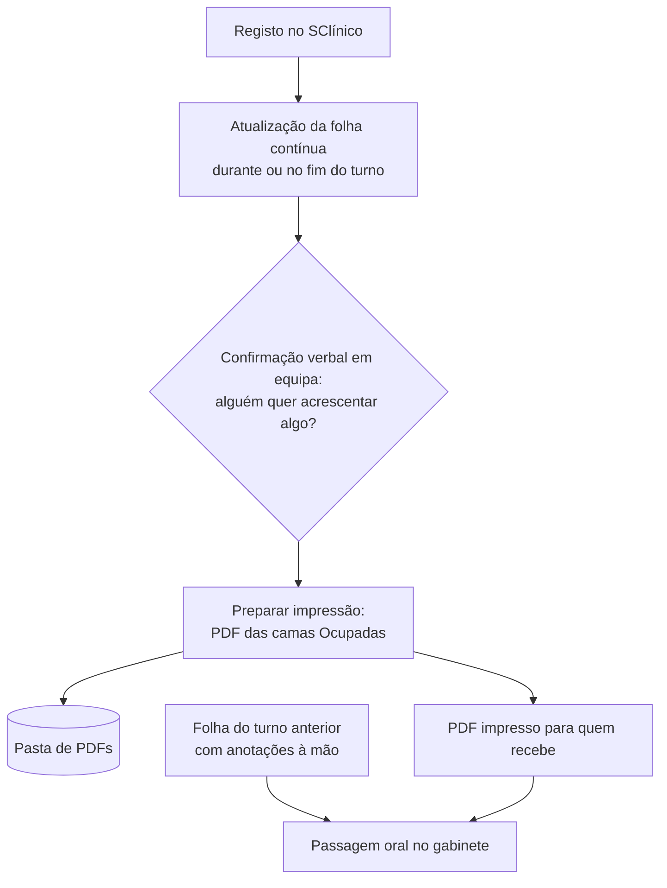
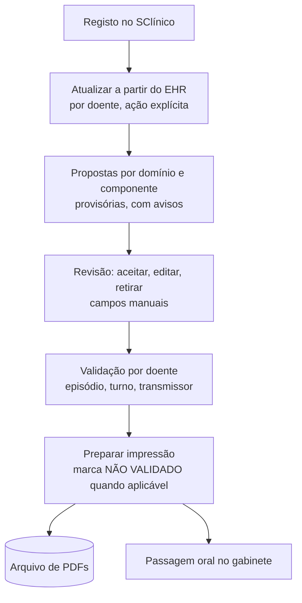
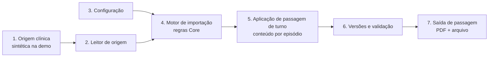

# Workflow To-Be e arquitetura conceptual

Versão 0.1 · novembro de 2026

> **Estado:** proposta conceptual. Não é integração implementada nem tem validação institucional. Base funcional: especificação UC-01 ([docs/01](01_UC-01_especificacao_funcional.md)).

Só a folha Word/VBA está implementada e em uso no serviço. Base de
dados, tratamento de dados e indicadores não existem. Os componentes da
arquitetura descrita na secção 4 são conceptuais; na demonstração
([docs/03](03_demonstracao_sintetica.md)) são simulados com dados
sintéticos.

O As-Is descreve a prática do meu serviço tal como a conheço. Não houve
observação formal, levantamento institucional nem medição de tempos.

# 1. As-Is: passagem de turno com a folha contínua

A folha de passagem de turno (Word/VBA, organizada segundo o método
ISBAR) é contínua: cada enfermeiro atualiza o conteúdo deixado pelos
turnos anteriores. Está organizada por cama. Cada cama tem um campo
Estado (Vaga / Ocupada), alterado manualmente pelo enfermeiro.

1.  Durante o turno, quando há tempo, o enfermeiro regista no SClínico e
    atualiza a folha.
2.  Quando não há tempo, a folha é atualizada no fim do turno.
3.  A equipa confirma verbalmente entre si se alguém quer acrescentar
    mais alguma coisa antes de imprimir.
4.  O botão «Preparar impressão» gera um PDF com as camas em estado
    «Ocupada» e guarda-o automaticamente numa pasta (consulta de turnos
    anteriores e auditorias).
5.  O PDF é impresso para os enfermeiros que recebem. Quando há muitas
    alterações, também para os transmissores.
6.  Caso contrário, os transmissores passam com a folha recebida no
    turno anterior, com as alterações anotadas à mão.
7.  A passagem é oral, num gabinete: cada transmissor passa as crianças
    que teve aos enfermeiros que recebem.
8.  Mudança de cama: o enfermeiro copia todos os campos para a cama
    nova, passa-a a «Ocupada» e passa a antiga a «Vaga», o que apaga os
    seus campos editáveis.
9.  Alta: a cama passa a «Vaga», o que apaga os campos editáveis e a
    deixa pronta para uma nova criança.

## 1.1 Pontos críticos observados

| **Ponto** | **Descrição** | **Efeito** |
|---|---|---|
| Escrita em dobro | O mesmo conteúdo é escrito no SClínico e na folha (passos 1 e 2). | É o problema que a UC-01 ataca. |
| Sem marca de revisão | O PDF inclui todas as camas ocupadas; nada indica se uma cama foi revista neste turno. | Conteúdo antigo pode parecer atual. |
| Duas versões na sala | Folha nova impressa e folha antiga anotada à mão (passo 6); as anotações por vezes falham. | Risco de divergência durante a passagem. |
| Episódio marcado pela cama | O fim do episódio depende de alguém passar a cama a «Vaga». | Se for esquecido, a criança seguinte entra com conteúdo da anterior. |
| Cópia na mudança de cama | Campos copiados um a um; a ordem importa. | Omissões; se a cama antiga passar a «Vaga» antes da cópia, o conteúdo só fica no último PDF guardado. |
| Confirmação verbal | A equipa pergunta se alguém quer acrescentar algo antes de imprimir, porque o PDF é único para todas as camas. | Depende de comunicação oral no fim do turno. |

# 2. To-Be: passagem de turno com importação controlada

| **#** | **Passo To-Be** | **Face ao As-Is** | **Regras** |
|---|---|---|---|
| 1 | O conteúdo coberto pela UC-01 é registado apenas no SClínico. A folha continua editável para contexto e campos manuais. | Muda: sem escrita em dobro para esse conteúdo. | - |
| 2 | Na preparação da passagem, habitualmente no fim do turno, o transmissor usa, por doente, «Atualizar a partir do EHR». | Novo. | C-01, C-04 a C-11 |
| 3 | O transmissor revê as propostas (aceitar, editar, retirar) e preenche os campos manuais. O conteúdo de turnos anteriores mantém-se. | Muda parcialmente. | C-03, C-06, C-07, C-12, C-14 |
| 4 | O transmissor valida a folha de cada doente. O estado de validação visível por doente substitui a confirmação verbal em equipa antes da impressão. | Muda. | C-14 |
| 5 | «Preparar impressão» gera e guarda o PDF dos doentes presentes. Doentes por validar saem com a marca «NÃO VALIDADO»; a impressão nunca é bloqueada. | Mantém-se, com marca nova. | C-14 |
| 6 | Passagem oral no gabinete. | Mantém-se. | - |
| 7 | Mudança de cama: altera-se a localização; o conteúdo segue o episódio. | Muda: sem cópia de campos. | C-02, ALT-08 |
| 8 | Alta ou novo episódio: a associação é pelo episódio; não há herança de conteúdo nem de validação entre episódios. | Muda: deixa de depender de passar a cama a «Vaga». | C-02, ALT-08, AC-10 |

## 2.1 O que o To-Be não resolve

- A folha antiga anotada à mão pode continuar a circular na passagem
  (passo 6 do As-Is). Está a jusante da UC-01.
- Conteúdo escrito em turnos anteriores pode permanecer sem revisão. A
  validação por doente obriga a uma decisão por turno, mas não garante
  que cada campo foi relido (risco residual da UC-01, secção 10).
- Limites da origem (volumes e débitos só em texto livre) mantêm-se.
- O ganho de tempo não é assumido. A validação por doente acrescenta
  passos; o balanço entre trabalho poupado e acrescentado só se conhece
  por medição antes/depois (tratado no plano de implementação,
  [docs/05](05_plano_de_implementacao.md)).

# 3. Pontos de decisão do enfermeiro

| **Passo** | **Decisão** | **Regra** |
|---|---|---|
| 2 | Pedir a importação, e quando | C-01 |
| 3 | Aceitar, editar ou retirar cada proposta | C-03, C-04 |
| 3 | Rever conteúdo herdado ou de turnos anteriores | C-06, ALT-03 |
| 3 | Decidir perante atualização sobre conteúdo editado | C-14, ALT-05, ALT-06 |
| 3 | Preencher campos de fonte externa | C-12 |
| 4 | Validar o doente | C-14 |
| 5 | Imprimir com doentes por validar, que saem marcados | C-14 |

Nenhuma decisão clínica é tomada pelo sistema. O sistema propõe, assinala
e regista; o enfermeiro decide.

# 4. Arquitetura conceptual

A arquitetura é neutra quanto à tecnologia da aplicação de passagem de turno: não
assume que seja a folha Word/VBA evoluída nem uma aplicação nova.

Nota: a folha Word/VBA atual está organizada por cama e não suporta a
associação por episódio sem alteração de estrutura. É essa organização
que obriga hoje à cópia de campos na mudança de cama.

## 4.1 Componentes

| **#** | **Componente** | **Função** | **Na demonstração** |
|---|---|---|---|
| 1 | Origem clínica (EHR) | Registos por intervenção final, com componentes e metadados (UC-01, 4.1) | Ficheiro sintético com essa estrutura |
| 2 | Leitor de origem | Obtém os registos do episódio e do período de referência | Lê o ficheiro sintético. Leitura real dependeria de interface autorizada, não verificada |
| 3 | Configuração | Eixos configuráveis por serviço e domínio (UC-01, 6.2) | Ficheiro de configuração |
| 4 | Motor de importação | Aplica as regras Core; produz propostas por episódio, domínio, intervenção e componente, com estado (C-07) e avisos | Simulado |
| 5 | Aplicação de passagem de turno | Conteúdo por episódio; cama como localização; edição; campos manuais; estado de validação por doente | Mínima, sem interface |
| 6 | Versões e validação | Versão por episódio, turno e transmissor; alteração após validação passa a «por validar» | Simulado |
| 7 | Saída de passagem | PDF dos doentes presentes, com marca «NÃO VALIDADO»; arquivo | Simulado (texto, não PDF) |

## 4.2 Fluxo entre componentes

Todas as setas são num só sentido. Nada é escrito de volta na origem
(C-03). O identificador de episódio vem da origem; a cama é atributo de
localização.

## 4.3 Fronteira de rigor

| **Categoria** | **Elementos** |
|---|---|
| Existe e está em uso | Folha Word/VBA; botão «Preparar impressão»; pasta de PDFs. Aparecem apenas no As-Is e não fazem parte deste repositório. |
| Simulado na demonstração, com dados sintéticos | Componentes 1 a 7. |
| Apenas conceptual | Interface real com o SClínico; autenticação; trilho de auditoria. Requisitos por definir, ligados às questões altas da UC-01. |
| Fora de âmbito | Integração com a plataforma de medicação; escrita na origem; avaliação de profissionais (C-13). |

# 5. Implicações para as fases seguintes

- Demonstração: implementa os componentes 1 a 7 com episódios fictícios
  e executa os critérios de aceitação, incluindo mudança de cama e novo
  episódio na mesma cama, que são os pontos onde o As-Is mostra maior
  risco.
- Plano de implementação: trata a mudança de prática da confirmação
  verbal para a validação por doente, o custo dessa validação, a
  circulação da folha antiga anotada e a medição antes/depois.

# 6. Decisões de desenho

| **Decisão** | **Estado** |
|---|---|
| Validação por doente substitui a confirmação verbal em equipa antes da impressão | Decidido |
| Impressão nunca bloqueada; doentes por validar saem com marca «NÃO VALIDADO» | Decidido |
| Arquitetura neutra quanto à tecnologia da aplicação, com nota sobre a organização por cama da folha atual | Decidido |
